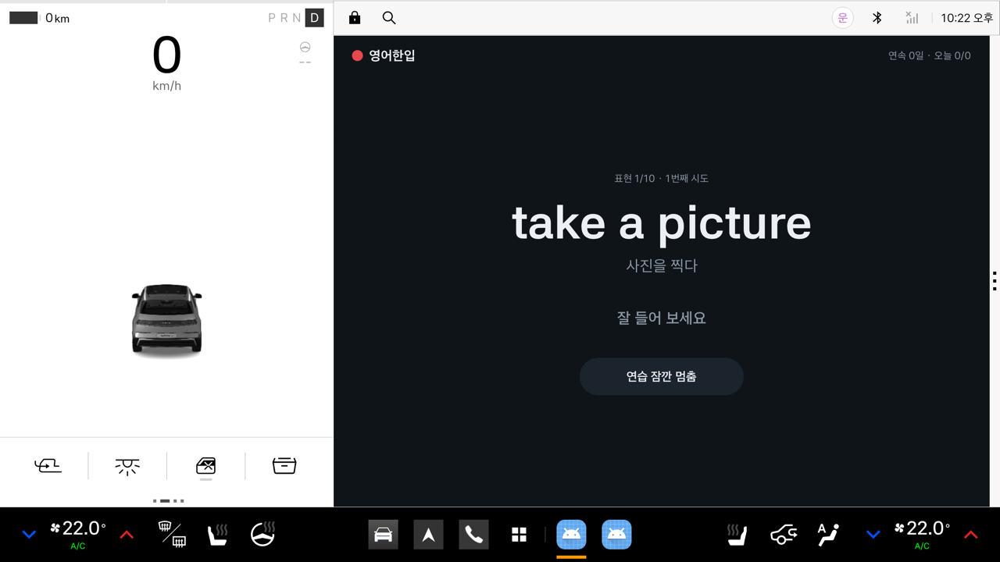
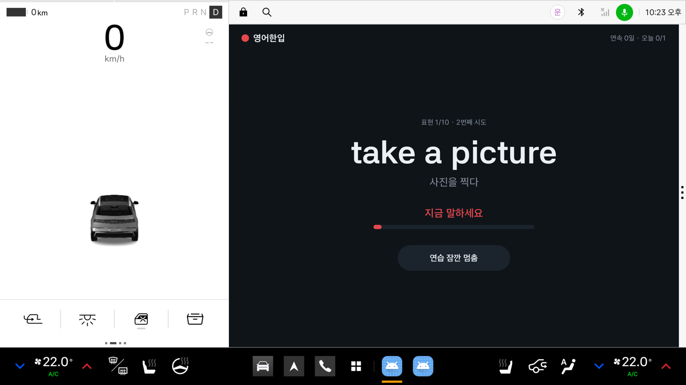
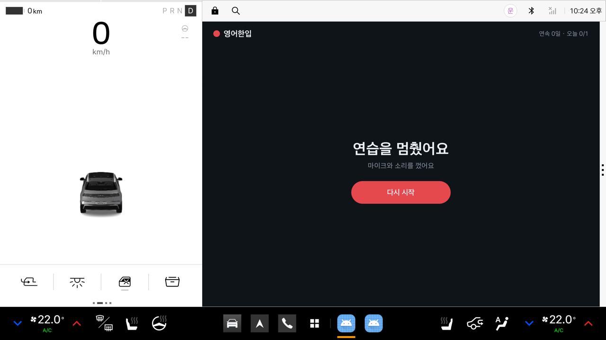
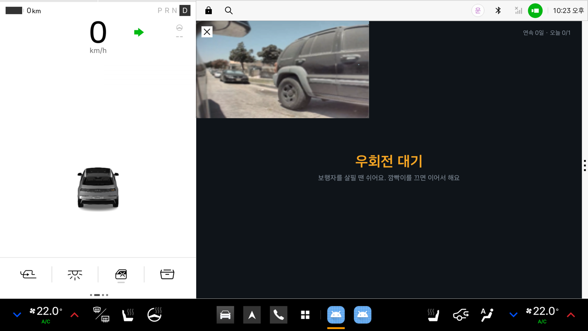
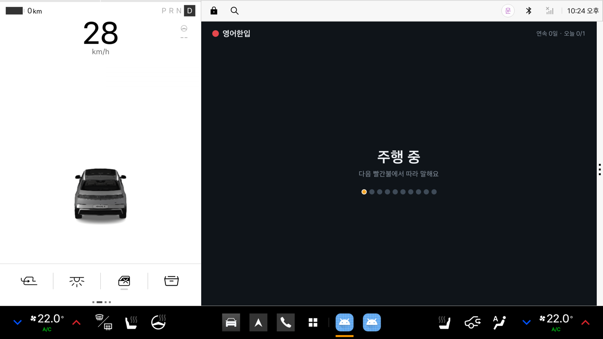
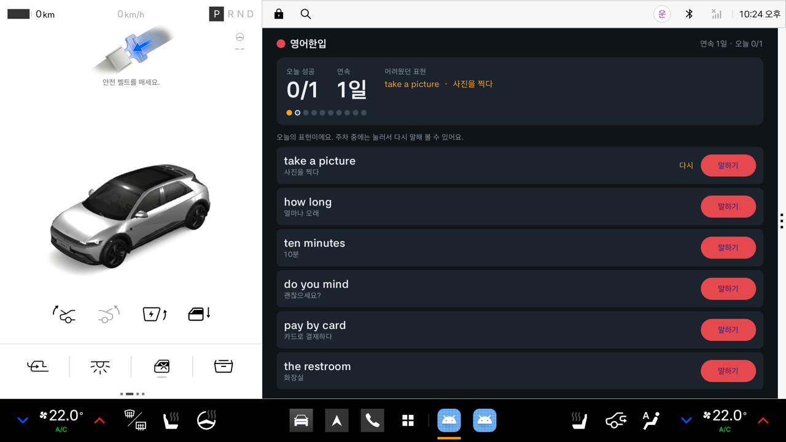

# 영어한입

**달릴 땐 듣고, 빨간불엔 말하고, 주차하면 복습하는 차 안 영어 말하기 습관 앱**

차가 멈추는 순간(빨간불)에 맞춰 짧은 영어 표현 하나를 소리 내 말하게 합니다.
기어·브레이크·속도·방향지시등·운전석 문으로 "지금 무엇을 해도 안전한가"를 판단해,
주행 중에는 듣기만, 정차 중에는 말하기, 주차 후에는 오늘 표현을 보며 다시 말하기로 바꿉니다.

- 팀명: 지게
- 플랫폼: Pleos Connect (Android Automotive OS), Kotlin · Jetpack Compose

---

## APK

| 파일 | 설명 |
|---|---|
| [`apk/지게_영어한입_release.apk`](apk/지게_영어한입_release.apk) | 서명된 release 빌드 (APK Signature Scheme v3) |

---

## 실행 방법

### 1. 에뮬레이터 준비 (Pleos Connect Emulator 2.1.0)
Pleos 공식 문서의 [개발 환경 설정](https://document.pleos.ai/docs/connect/guide/getting-started/application-development/setup-connect-sdk-emulator)대로 설치합니다.

1. Android Studio → SDK Manager → SDK Update Sites에 Pleos 시스템 이미지 사이트를 추가합니다.
   - Mac(arm64): `https://nexus-playground.pleos.ai/repository/raw-releases/connect-avd/2.x/crp-arm64-sys-img.xml`
   - Windows/Linux: `https://nexus-playground.pleos.ai/repository/raw-releases/connect-avd/2.x/crp-sys-img.xml`
2. SDK Platforms → API 34 → **Pleos Connect System Image**를 설치합니다.
3. Device Manager → Automotive → **Pleos Connect v2.1.0**으로 AVD를 만듭니다 (RAM 4GB, Cold boot 권장).
4. 에뮬레이터를 켜고, 부팅이 끝나면 시간대를 서울로 바꿉니다. 오후 2시 전에는 업무 영어, 그 뒤에는 일상 영어 세트가 나오기 때문입니다(기본 시간대는 미국 서부).
   ```bash
   adb shell settings put global auto_time_zone 0   # 자동 시간대가 미국 서부로 되돌리지 않게 끔
   adb shell cmd alarm set-timezone Asia/Seoul
   ```

### 2. 설치와 실행
```bash
adb install apk/지게_영어한입_release.apk
adb emu avd hostmicon          # 에뮬레이터에 Mac/PC 마이크 연결 (부팅 후 한 번만)
```
앱 목록에서 **영어한입**을 엽니다. 처음 실행하면 권한 두 가지를 허용합니다.
- **마이크**: 말하기 인식
- **위치 정보**: 차량 속도(`CAR_SPEED`) 권한이 AAOS에서 위치 그룹으로 묶여 이렇게 표시됩니다. 위치는 쓰지 않습니다.

> 부팅 직후에는 시스템이 주행 화면·내비를 앞으로 띄울 수 있습니다. 부팅하고 2~3분 뒤 앱을 열면 안정적입니다.

### 3. 버추얼 콘솔로 운전해 보기
```bash
adb forward tcp:8088 tcp:8088   # 그 뒤 브라우저에서 http://127.0.0.1:8088
```
콘솔의 **Emulation Controls**와 **ACCEL / BRAKE** 페달로 차량 상태를 바꿉니다.

| 해 볼 것 | 콘솔 조작 | 앱 반응 |
|---|---|---|
| 출발 | Gear **D** → **ACCEL** 누르고 있기 | 출발 인사, "주행 중", 다음 표현을 뜻 → 영어로 미리 듣기 |
| 빨간불 | 속도가 붙은 뒤 **Brake Pedal 100%** | 2초 뒤 정차 화면: 표현과 뜻 → "띵" → 말하기 → 판정. 틀리면 최대 3번 다시, 서 있는 동안 다음 표현으로 이어짐 |
| 잠깐 멈춤 | 정차 화면의 **"연습 잠깐 멈춤"** 버튼 | 마이크와 소리를 끄고 "다시 시작"을 누를 때까지 쉼 |
| 말하다가 출발 | Brake Pedal 0% → ACCEL | 속도가 붙는 즉시 마이크를 끄고 화면을 숨김 |
| 좌회전 신호 대기 | 정차 중 **Turn Signal State → Blink left** | 그대로 정차로 보고 연습 (긴 빨간불) |
| 우회전 대기 | 정차 중 **Turn Signal State → Blink right** | "우회전 대기 · 보행자를 살필 땐 쉬어요", 말하기 중단 |
| 오늘 표현 다 함 | 10개를 모두 말할 때까지 정차 | "오늘 10개를 모두 했어요"와 결과 카드 |
| 주차 | Gear **P** | 오늘 결과를 소리로 정리, 결과 카드, 오늘 표현 목록과 "말하기" |
| 하차 | P단에서 **Door Position → Front left → Open** | 운행 끝, 결과 저장 (시동을 끈 뒤라 소리는 내지 않음) |

> 에뮬레이터는 소리가 1~3초 늦고 에코 제거가 꺼져 있어, 앱이 읽어 준 소리가 마이크로 다시 들어갈 수 있습니다. **이어폰**을 쓰면 정확합니다.

---

## 화면과 시연 영상

- 시연 영상(59초): [`docs/demo/yeongeo-hanip_demo.mp4`](docs/demo/yeongeo-hanip_demo.mp4)
  - 에뮬레이터 화면 녹화입니다. 에뮬레이터 녹화가 소리를 군데군데 빠뜨려서, 소리는 앱 로그에 남은 실제 문장과 시각에 맞춰 합성 음성으로 다시 입혔습니다.
  - 시연 시간을 줄이려고 디버그 빌드에서 오늘 표현 수를 3개로 줄여 찍었습니다(`--ei phrases 3`). 제출용 빌드는 하루 10개입니다.
- 화면 캡처(제출용 빌드): [`docs/screenshots/`](docs/screenshots/)

| 정차: 표현과 뜻 | 말할 차례 | 틀렸을 때 |
|---|---|---|
|  |  |  |
| **잠깐 멈춤** | **우회전 대기** | **주행 중** |
|  |  |  |
| **주차 후 복습** | | |
|  | | |

---

## 테스트 환경과 설정

| 항목 | 값 |
|---|---|
| 에뮬레이터 | Pleos Connect Emulator 2.1.0, 시스템 이미지 `android-34 / pleos_car_emulator` |
| 빌드 | Android Studio, Gradle 8.11.1, AGP 8.7.3, Kotlin 2.0.21, JDK 17 |
| SDK 버전 | compileSdk 35, targetSdk 34, **minSdk 28** |
| Pleos SDK | `ai.pleos.playground:Vehicle:2.3.2`, `TextToSpeech:3.3.1`, `SpeechToText:3.3.1` |
| 음성 엔진 | 차량 내부 엔진(ON_DEVICE). 네트워크와 앱 등록 없이 동작 |
| 외부 API 키 | **필요 없음** |

### 사용하는 SDK·API와 퍼미션
| 기능 | SDK / API | 퍼미션 |
|---|---|---|
| 주행·정차·주차 판단 | Vehicle SDK `Gear`, `Brake` | `pleos.car.permission.CAR_DRIVE` |
| 우회전 대기 | Vehicle SDK `TurnSignal` | `pleos.car.permission.CAR_LIGHTS` |
| 운행 끝(하차) | Vehicle SDK `Door` | `pleos.car.permission.CAR_DOORS` |
| 차량 속도 | AAOS `CarPropertyManager` (`PERF_VEHICLE_SPEED`) — Pleos SDK에 속도 API가 없음 | `android.car.permission.CAR_SPEED` |
| 표현 들려주기 | TextToSpeech SDK (en-US, ko-KR) | `pleos.car.permission.TTS_SERVICE` |
| 말하기 인식 | SpeechToText SDK (en-US) | `pleos.car.permission.STT_SERVICE`, `RECORD_AUDIO` |
| 음악 처리 | Android 오디오 포커스 (말할 때 멈춤, 미리 듣기 때 줄임) | 없음 |

### 직접 빌드하기 (선택)
```bash
cd android
./gradlew assembleDebug          # app/build/outputs/apk/debug/app-debug.apk
./gradlew testDebugUnitTest      # 단위 테스트
```
release 빌드는 서명 키가 필요합니다. `android/local.properties`에 아래 값을 넣습니다(Git에는 올리지 않습니다).
```properties
release.storeFile=../release.keystore
release.storePassword=...
release.keyAlias=...
release.keyPassword=...
```
서버 음성(HYBRID)을 시험하려면 Pleos Playground My Project 자격 증명과 `pleos.useServer=true`를 같은 파일에 넣습니다. 기본은 끔입니다.

---

## 구조

Jetpack Compose + 클린 아키텍처 + MVI, 단일 모듈입니다.

```
android/app/src/main/java/app/redlight/hanmadi/
├── domain/        순수 Kotlin. Android·Pleos SDK에 의존하지 않음
│   ├── DrivePhaseDetector   차량 신호 → 운전 상태(주행/정차/우회전 대기/주차…)
│   ├── TripTracker          운행 시작·끝 (운전석 문 기준)
│   ├── AnswerJudge          인식된 말 vs 목표 표현 (핵심 단어 + 소리 기준 비교)
│   └── StopPracticeUseCase  정차 중 한 번의 말하기: 뜻 → 영어 → 듣기 → 판정 → 피드백
├── data/          Pleos SDK·Android API를 감싸 domain 모델과 Flow로 바꿈
└── presentation/  Compose 화면 + MVI (State / Intent / SideEffect / ViewModel)
```

설계 근거는 [`docs/design/drive-phase-rules.md`](docs/design/drive-phase-rules.md)에 있습니다.
